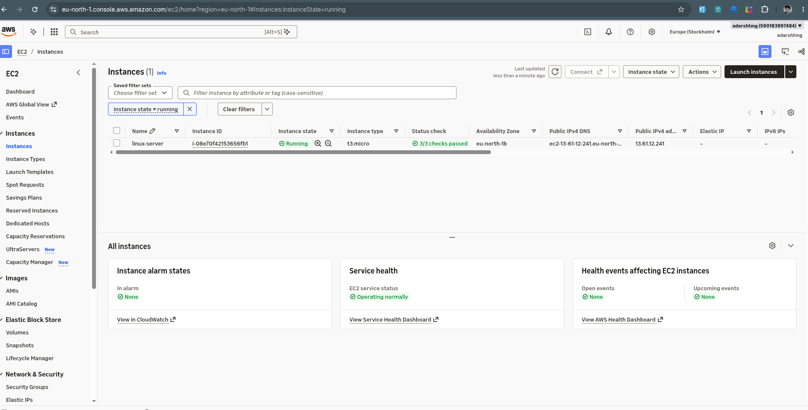
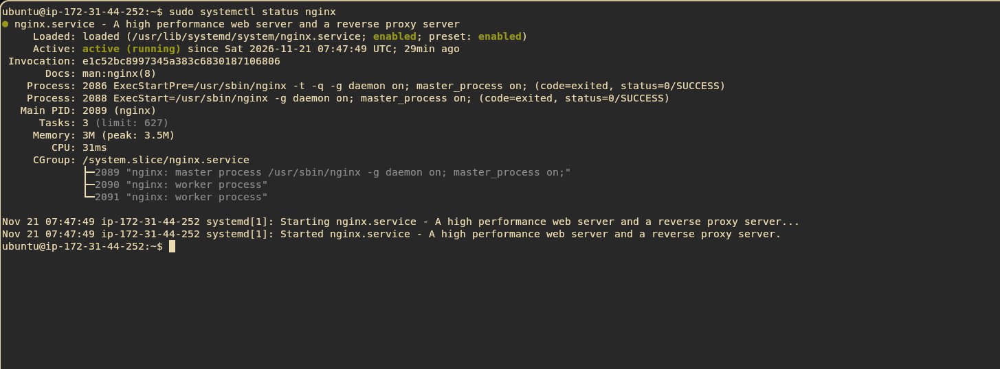
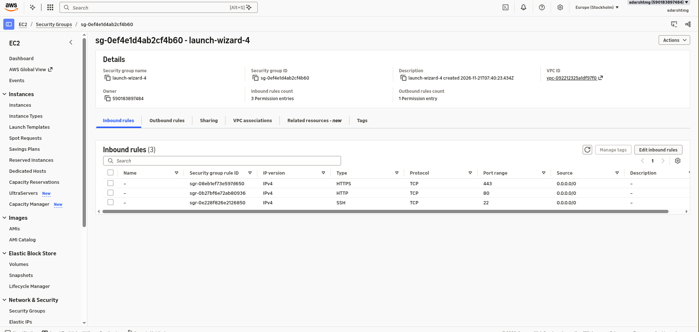
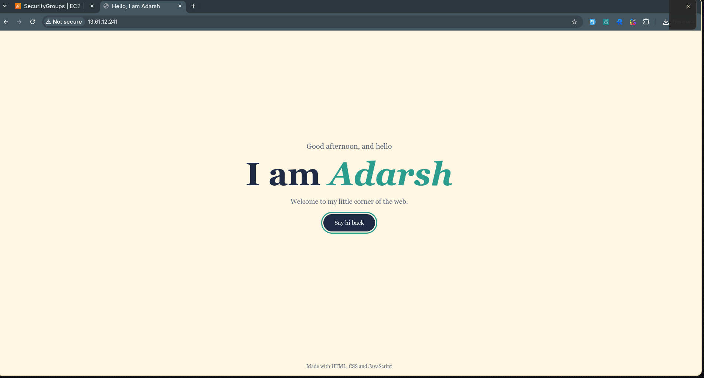
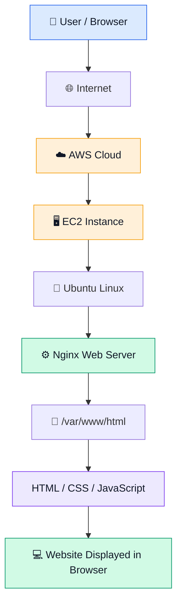

# 🚀 Static Website Hosting on AWS EC2 using Nginx

<p align="center">
  
  
  
  
</p>

---

## 📌 Project Overview

In this project, I deployed a static website on an AWS EC2 instance running Ubuntu Linux. I used Nginx as a web server to host and serve the website over the internet.

The main objective of this project was to gain hands-on experience with AWS EC2, Linux server administration, Nginx configuration, and static website deployment.

**🌐 Live Website:** [http://13.61.12.241](http://13.61.12.241)

---

## 📸 Project Screenshots

### 1. AWS EC2 Instance

<p align="center">
  
</p>

 

### 3. Nginx Status

<p align="center">
  
</p>

### 4. AWS Security Group Configuration

<p align="center">
  
</p>

### 5. Static Website Live on EC2

<p align="center">
  <a href="http://13.61.12.241">
    
  </a>
</p>

<p align="center">
  <a href="http://13.61.12.241">🔗 Visit Live Website</a>
</p>

### 6. Website Deployment Through Terminal

<p align="center">
  
</p>

---

## 🛠️ Technologies Used

| Technology | Purpose |
|---|---|
| AWS EC2 | Cloud server hosting |
| Ubuntu Linux | Operating system |
| Nginx | Web server |
| HTML | Website structure |
| CSS | Website styling |
| JavaScript | Website functionality |
| SSH | Remote server connection |
| AWS Security Groups | Network traffic control |

---

## 🚀 Project Implementation

### 1. Launching an AWS EC2 Instance

- Logged in to the AWS Management Console.
- Created an EC2 instance.
- Selected Ubuntu Server as the operating system.
- Configured the instance and generated an SSH key pair.
- Configured the required security group rules.

### 2. Connecting to EC2 Using SSH

Connected to the EC2 instance from my local machine using SSH.

```bash
ssh -i your-key.pem ubuntu@13.61.12.241
```

### 3. Updating the Ubuntu Server

Updated the system packages.

```bash
sudo apt update
sudo apt upgrade -y
```

### 4. Installing Nginx

Installed Nginx on the Ubuntu server.

```bash
sudo apt install nginx -y
```

Started and enabled the Nginx service.

```bash
sudo systemctl start nginx
sudo systemctl enable nginx
```

Verified the Nginx service status.

```bash
sudo systemctl status nginx
```

### 5. Deploying the Static Website

- Transferred static website files (HTML, CSS, JavaScript, and assets) to the EC2 instance.
- Placed the website files inside the Nginx web root directory.
- Configured the appropriate file permissions.

Example:

```bash
sudo cp -r website/* /var/www/html/
```

### 6. Configuring Nginx

Used Nginx to serve the static website through the EC2 instance's public IP address.

Nginx served the website files from its configured document root.

### 7. Configuring AWS Security Groups

Configured the EC2 security group to allow the required inbound traffic.

| Type | Port | Purpose |
|---|---|---|
| SSH | 22 | Remote server access |
| HTTP | 80 | Website access |
| HTTPS | 443 | Secure website access (if configured) |

**Note:** SSH access should ideally be restricted to my own IP address.

### 8. Testing the Website

After completing the deployment, I accessed the website using the EC2 instance's public IP address.

**Website URL:** http://13.61.12.241

Successfully verified that the static website was accessible through the internet.

---

## 🏗️ Project Architecture

The following diagram illustrates how a user accesses my static website hosted on AWS EC2 using Nginx.



### Architecture Explanation

1. **User:** Opens the website using a web browser.
2. **Internet:** Sends an HTTP request to the EC2 public IP.
3. **AWS EC2:** Receives the incoming request.
4. **Ubuntu Linux:** Runs the server operating system.
5. **Nginx:** Handles the HTTP request and serves static files.
6. **Website Files:** Nginx retrieves HTML, CSS, JavaScript, and other assets from `/var/www/html`.
7. **Browser:** Displays the requested website to the user.

---

## 📚 What I Learned

Through this project, I gained practical experience in:

- Creating and configuring AWS EC2 instances.
- Working with Ubuntu Linux servers.
- Connecting to remote servers using SSH.
- Installing and managing Nginx.
- Deploying static websites on cloud infrastructure.
- Configuring AWS Security Groups.
- Understanding how web servers handle HTTP requests.
- Hosting websites using AWS cloud services.

---

## 🔮 Future Improvements

- Configure a custom domain name.
- Enable HTTPS using Let's Encrypt SSL certificates.
- Automate website deployment using GitHub Actions.
- Configure Nginx virtual hosts.
- Implement automated backups and monitoring.
- Set up a CI/CD pipeline for automated deployment.

---

## 👨‍💻 Author

**Adarsh Tamang**

- GitHub: [Adarsh Tamang](https://github.com/your-username)
- Project: AWS EC2 Static Website Hosting

---

<p align="center">
  ⭐ If you found this project useful, feel free to star this repository!
</p>
